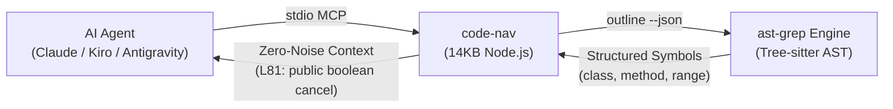

# code-nav

> Zero-noise AST code navigation MCP server for AI coding agents.

LLM 에이전트가 코드베이스를 탐색할 때 발생하는 `grep` 주석/변수 노이즈와 무분별한 전체 파일 읽기(`read_file`)로 인한 컨텍스트 낭비를 방지합니다. 무거운 LSP 데몬 없이 `ast-grep`(Tree-sitter)을 통해 선언부와 구조만 밀리초 단위로 추출합니다.



---

## Tools

* **`code_nav_def`**: AST 기반 정의 선언부 탐색. 주석/문자열/변수를 배제하고 클래스, 인터페이스, 함수, 메서드만 반환 (`OrderService.cancel` 형식 지원).
* **`code_nav_outline`**: 파일 심볼 계층 구조와 라인 번호 확인. 파일 본문을 읽기 전 구조 파악용.
* **`code_nav_refs`**: AST 패턴(`$OBJ.method($$$)`) 기반 호출부 및 인스턴스화 위치 탐색.
* **`code_nav_repomap`**: 디렉터리 내 핵심 선언부(Class/Interface) 요약 맵 생성.

---

## Benchmark (vs Naive Exploration)

Kiro CLI (`claude-haiku-5.5`) 환경에서 Spring Boot 샘플 프로젝트 동일 Intent 실행 실측치:

| Metric | Without MCP (`grep` + `read`) | With `code-nav` | Delta |
| :--- | :---: | :---: | :---: |
| **API Requests** | 4 calls | **3 calls** | **-25%** |
| **Tool Cycles** | 3 cycles | **2 cycles** | **-33%** |
| **Turn Latency** | 13.4s | **8.9s** | **-33%** |
| **File Reading** | Full file (115 lines) | **Bounded read (25 lines)** | **-78% lines** |
| **Credit Cost** | 0.0164 | **0.0109** | **-33%** |

*전체 파일을 읽고 줄 번호를 추적하는 CoT(Thinking) 토큰 생성이 54%(570자 -> 260자) 감소하고, 도구 왕복 1회 단축으로 매 턴 누적 전송되는 14,000 토큰의 입력이 생략됨.*

---

## Prerequisites

* **Node.js** >= 18
* **ast-grep**
  ```bash
  # macOS / Linux
  npm install -g @ast-grep/cli  # or brew install ast-grep

  # Windows
  winget install ast-grep.ast-grep  # or npm install -g @ast-grep/cli
  ```

---

## Setup

### Claude Code
```bash
claude mcp add code-nav -- npx -y github:djoo-lgcns/code-nav
```

### Kiro CLI
```bash
kiro-cli mcp add code-nav -- npx -y github:djoo-lgcns/code-nav
```

### Antigravity / Cursor / Windsurf
`mcp_config.json` 또는 `mcp.json`:
```json
{
  "mcpServers": {
    "code-nav": {
      "command": "npx",
      "args": ["-y", "github:djoo-lgcns/code-nav"]
    }
  }
}
```

---

## Agent Directive (Optional)

`AGENTS.md` 또는 `team.md`(AI-DLC Workflow 환경에서)에 추가하여 에이전트의 탐색 패턴을 강제할 수 있습니다:

```markdown
## Code Navigation
1. Find definitions: Call `code_nav_def(symbol)` first (avoid grep noise).
2. Inspect structure: Call `code_nav_outline(filePath)` before opening files >100 lines.
3. Bounded reading: Read only targeted ranges (±20 lines) around target symbols.
```

---

## CLI Usage

터미널 직접 실행 및 디버깅:

```bash
# 정의 탐색 (단일 심볼 및 클래스.메서드)
npx -y github:djoo-lgcns/code-nav def cancel backend/
npx -y github:djoo-lgcns/code-nav def OrderService.cancel backend/

# 파일 심볼 계층 구조 확인
npx -y github:djoo-lgcns/code-nav outline src/OrderService.java

# 호출처 및 인스턴스화 위치 탐색
npx -y github:djoo-lgcns/code-nav refs cancel backend/
```

---

## License
MIT
